### Featured projects

All four live in [Finance](https://github.com/Makayacine/Finance):

- **[SBA small-business credit risk](https://github.com/Makayacine/Finance/tree/main/sba-credit-risk-ecs-dynamo)**: PD, loss severity, expected loss, IFRS 9 stage and IRB capital for the 281,077 open loans among 1,639,728 SBA 7(a) loans.
- **[Latvian company default model](https://github.com/Makayacine/Finance/tree/main/latvia-company-credit-glue-delta)**: a 12-month probability of default for 115,088 Latvian companies, from the annual accounts they file.
- **[Sovereign yield curves and rate risk](https://github.com/Makayacine/Finance/tree/main/sovereign-curves-cicd-lambda-glue-ecs)**: US Treasury curves from FedInvest prices, checked against the Federal Reserve's GSW curve, with South Africa through the same code.
- **[Crypto market statistical refinery](https://github.com/Makayacine/Finance/tree/main/crypto-ticks-refinery-glue-dynamo)**: 340,971,834 Binance trades aggregated into 1,607,040 five-second bars.

Earlier research: [Masters dissertation](https://github.com/Makayacine/Masters-Dissertation), [Transcriptomics](https://github.com/Makayacine/Transcriptomics), [Chemistry](https://github.com/Makayacine/Chemistry).
